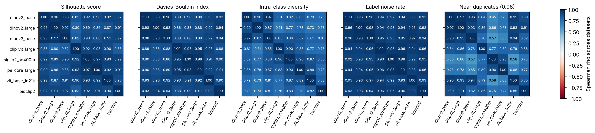
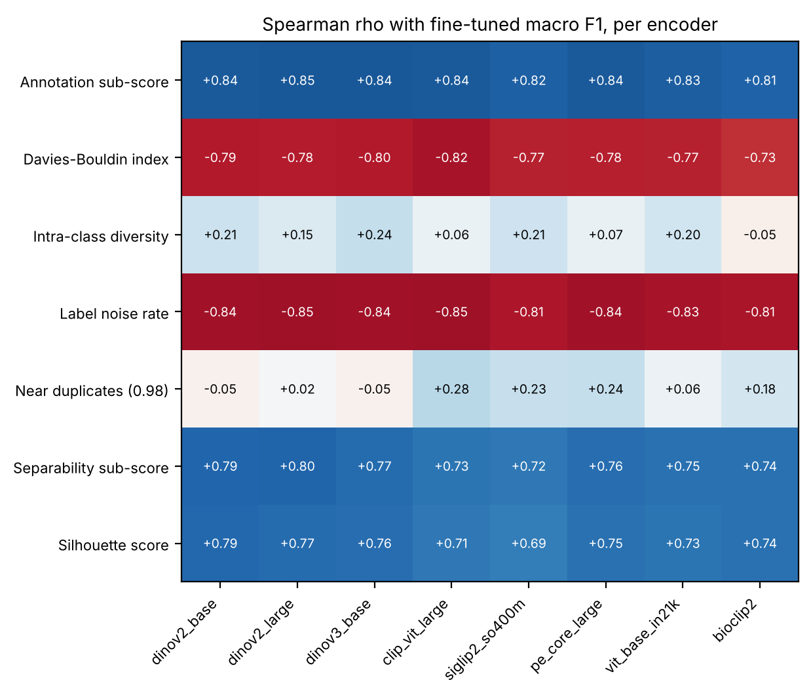
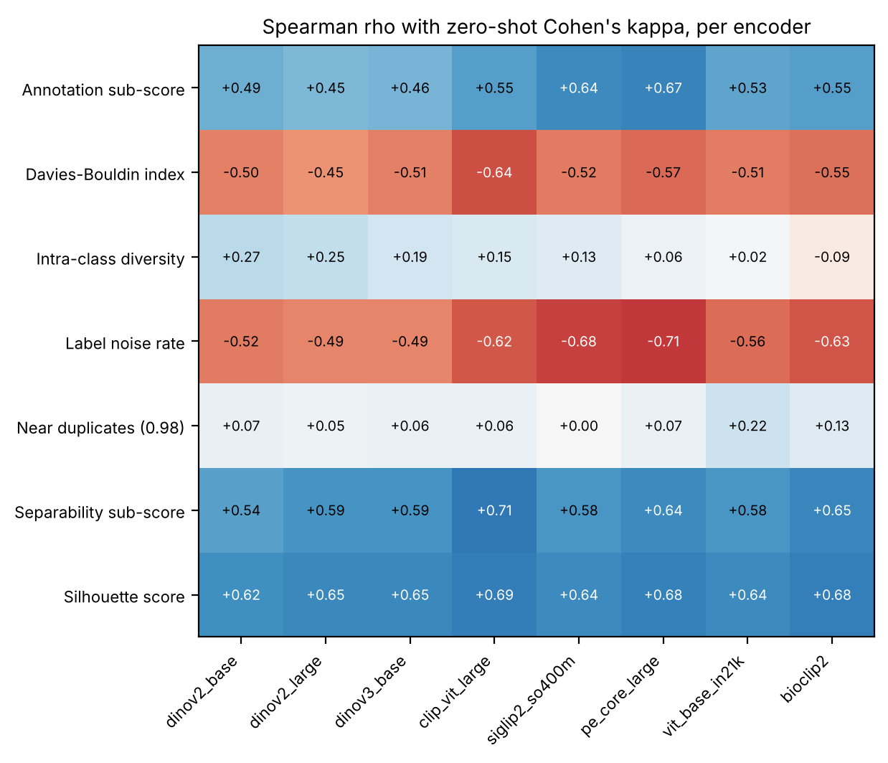
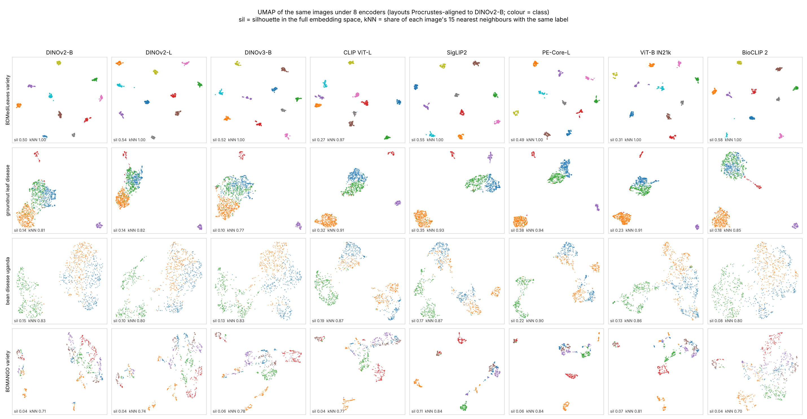

# Encoder Sensitivity

## Why we ran this

Many benchmark metrics are measured on image embeddings: near duplicates, class separability (silhouette and Davies-Bouldin), intra-class diversity and label noise. The benchmark computes all of them with one encoder, DINOv2-Base. If we had picked a different encoder, would the scores still say the same thing about a dataset? This experiment checks that.

## What we did

We took all 84 curated datasets that have benchmark results and embedded every image again with 8 encoders. Everything else stayed the same: the same images, the same labels and the same train, validation and test splits as the benchmark. Then we recomputed each embedding metric with each encoder.

The 8 encoders come from four families:

- **Self-supervised, image only:** DINOv2-B (the benchmark's encoder), DINOv2-L and DINOv3-B.
- **Supervised on ImageNet-21k labels:** ViT-B.
- **Image-text, CLIP-style:** CLIP ViT-L/14 and BioCLIP 2, which was trained on species images.
- **Large-scale image-text:** SigLIP2 So400m and PE-Core-L.

As a sanity check, the DINOv2-B embeddings match the ones saved by the benchmark exactly, so every row lines up with the original runs.

We compared encoders in three ways. First, whether they rank the 84 datasets in the same order (Spearman correlation). Second, whether each encoder's metrics still predict how well models learn a dataset, using fine-tuned F1 and zero-shot kappa on the 20 datasets from the earlier experiments. Third, for label noise, whether they flag the same images.

## What we found

### Encoders agree on which datasets are better or worse

For most metrics, the encoders put the datasets in nearly the same order. Label noise agrees the most (0.95 on average between encoder pairs), followed by Davies-Bouldin (0.92), silhouette (0.90), intra-class diversity (0.82) and near duplicates (0.80). So if a dataset looks noisy or poorly separated under DINOv2, it looks that way under the other encoders too.

<p align="center">
	
</p>

*Each cell is the correlation between two encoders' rankings of the 84 datasets. Darker blue means closer agreement.*

Encoders from the same family agree more with each other. For near duplicates, the three DINO models agree at 0.95, while DINO and the large image-text models agree at only 0.72. The supervised ViT-B behaves almost exactly like the DINO models.

### The actual numbers depend a lot on the encoder

Rankings hold, but the raw values move. Image-text encoders, especially SigLIP2 and PE-Core, place all images much closer together in embedding space. That changes any metric that uses a fixed cut-off.

Near duplicates are the clearest case. With a cosine cut-off of 0.98, DINOv2-B flags a median of 9% of a dataset's images as near duplicates. SigLIP2 flags 62% and PE-Core 52%, so at that cut-off almost every dataset looks full of duplicates and the ranking gets noisy. When those encoders use a stricter cut-off of 0.99, their rankings line up with DINOv2 again (0.86 to 0.94). The disagreement comes from the cut-off, not from the encoders seeing different duplicates.

Intra-class diversity shows the same pattern. Under image-text encoders, the values are about half as large. This exposes a problem with the diversity sub-score itself: it gives full marks above 0.4, and under DINOv2, 90% of datasets already pass that. The sub-score barely separates datasets today, and its low agreement between encoders (0.53) comes from that cut-off rather than real disagreement.

Silhouette also shifts. PE-Core sees the classes as the most separated (median 0.18, against 0.11 for DINOv2-B), but it still ranks datasets much like the others.

### The link with model performance holds for every encoder

The metrics that predicted fine-tuned F1 with DINOv2 do so with every encoder. Silhouette correlates with F1 between 0.69 and 0.79, and label noise between -0.81 and -0.85, whichever encoder we use.

<p align="center">
	
</p>

For zero-shot kappa, the image-text encoders look slightly better (for example, label noise at -0.71 with PE-Core against -0.52 with DINOv2). With only 20 datasets, that gap is within the noise, so we cannot say one encoder is better. Near duplicates and intra-class diversity show no link with performance under any encoder.

<p align="center">
	
</p>

### Encoders agree on how noisy a dataset is, not on which images are wrong

Label noise rates agree closely between encoders, but the images they flag as mislabeled overlap very little. On average, two encoders share only about a quarter of their flagged images. Of all flagged images, 37% are flagged by just one encoder and only 8% by all eight.

Within each encoder, the noise rate also tracks silhouette closely (around -0.8). Datasets with poorly separated classes get higher noise estimates. So the noise rate partly measures how hard the classes are to tell apart, not only wrong labels. The dataset-level rate is useful for ranking datasets, but a single image being flagged should not be taken as proof that its label is wrong.

### Individual datasets can still move

Overall agreement is high, but single datasets do shift. A typical dataset moves 17 places out of 84 in the silhouette ranking, 24 for near duplicates and 26 for diversity. The biggest jump is DIMPSAR medicinal leaf, which moves 58 places in silhouette depending on the encoder. Comparing two datasets with close scores is less reliable than comparing datasets far apart.

### What the embedding spaces look like

The figure below shows 2D UMAP views of four datasets under all eight encoders. Colors are classes, and the panels are aligned to DINOv2-B so they are easier to compare.

<p align="center">
	
</p>

*sil is the silhouette score in the full embedding space. kNN is the share of each image's 15 nearest neighbours with the same label.*

The big picture is the same everywhere. A well-separated dataset like BDMediLeaves forms clean clusters with every encoder, and a hard one like BDMANGO looks mixed with every encoder. The differences show up in the middle. In groundnut leaf disease, two classes blend together under the DINO models (silhouette 0.14), while the image-text encoders pull them apart (up to 0.38).

Up close, the spaces are quite different. On average, two encoders share only about 31% of each image's 15 nearest neighbours. So the overall structure agrees, but which images sit next to each other does not.

## What this means

- The embedding metrics describe the dataset, not just DINOv2, as long as they are used to compare datasets.
- Fixed cut-offs (0.98 for near duplicates, 0.4 for diversity, 0.1 for noise) only fit DINOv2. Another encoder needs its own cut-offs, or cut-offs set by percentile.
- The diversity sub-score needs a new cut-off even with DINOv2.
- Treat label noise as a dataset-level warning, not a list of wrong labels.
- When reporting embedding metrics, name the encoder.

## How to run

From the repo root on FARM:

```bash
source farm_environment.sh
export UV_PROJECT_ENVIRONMENT=$PWD/.agml-benchmarking-vllm
uv run python -m experiments.pipelines.encoder_sensitivity.run --prefetch-only    # login node, downloads only
uv run python -m experiments.pipelines.encoder_sensitivity.run --smoke-test       # checks every encoder loads
sbatch experiments/slurm/encoder_sensitivity/encoder_sensitivity.sbatch
uv run python -m experiments.pipelines.encoder_sensitivity.analysis                # after the job finishes
```

DINOv3 is gated on Hugging Face, so accept its license and run `hf auth login` before prefetching. The encoders, cut-offs and dataset list are in `experiments/slurm/encoder_sensitivity/config.yaml`.

`run.py` embeds the datasets and computes the metrics. `analysis.py` builds the comparison tables, figures and `report.md`. Results go to `experiments/results/encoder_sensitivity/` and figures to `experiments/figures/encoder_sensitivity/`. The encoders themselves live in `core/embeddings/encoders.py`, shared with the benchmark.
